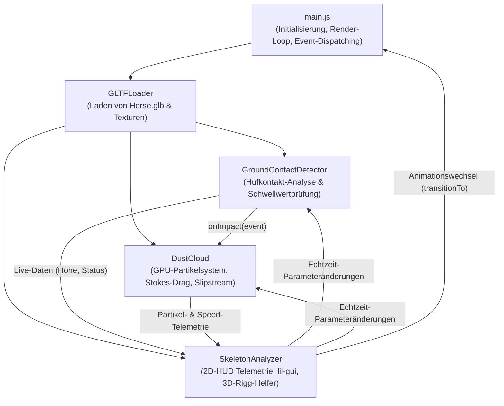
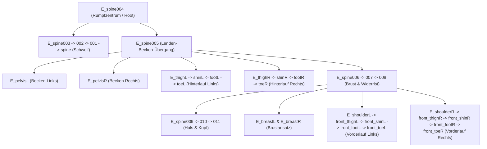

# Three.js Dokumentation: Animiertes 3D-Pferd mit Biomechanik, Staubpartikelsystem & GUI-Steuerung

Diese Dokumentation erklärt die Architektur, mathematische Modellierung und den modularen Codeaufbau der Three.js-Anwendung zur Echtzeitsimulation und Analyse eines geriggten 3D-Pferdemodells. Besonderes Augenmerk liegt auf der biomechanischen Hufkontakt-Erkennung, der physikalisch basierten Staubwolken-Simulation mit Rückwärtsimpuls sowie den getroffenen architektonischen **Designentscheidungen**.

---

## Inhaltsverzeichnis

1. [Systemarchitektur & Modulübersicht](#1-systemarchitektur--modulübersicht)
2. [Szenenaufbau, Rendering & Kamera](#2-szenenaufbau-rendering--kamera)
3. [Beleuchtung & visuelle Referenzen](#3-beleuchtung--visuelle-referenzen)
4. [Textur-Pipeline & dynamischer Texturwechsel](#4-textur-pipeline--dynamischer-texturwechsel)
5. [GLTF/GLB-Ladelogik & Szenengraph-Traversierung](#5-gltfglb-ladelogik--szenengraph-traversierung)
6. [Skelettanimations-Pipeline & Transition-Handling](#6-skelettanimations-pipeline--transition-handling)
   - [6.1 Freeze-Bugfix: `warp: true` vs. `fadeIn`/`fadeOut`](#61-freeze-bugfix-warp-true-vs-fadeinfadeout)
   - [6.2 Zero-Duration Clip-Normalisierung & Aliasing](#62-zero-duration-clip-normalisierung--aliasing)
7. [Render-Loop & Frame-Timing (`THREE.Timer`)](#7-render-loop--frame-timing-threetimer)
8. [Biomechanische Hufkontakt-Erkennung (`GroundContactDetector`)](#8-biomechanische-hufkontakt-erkennung-groundcontactdetector)
   - [8.1 Knochenidentifikation & duale Schwellwerte](#81-knochenidentifikation--duale-schwellwerte)
   - [8.2 Event-Pipeline (`onImpact` & `onLiftOff`)](#82-event-pipeline-onimpact--onliftoff)
   - [8.3 Visuelle 3D-Indikatoren & Z-Fighting-Prävention](#83-visuelle-3d-indikatoren--z-fighting-prävention)
9. [Physikalisch basierte Staubwolken-Simulation (`DustCloud`)](#9-physikalisch-basierte-staubwolken-simulation-dustcloud)
   - [9.1 Kinematik: Laufrichtung, Gangart & Rückwärts-Kick](#91-kinematik-laufrichtung-gangart--rückwärts-kick)
   - [9.2 Mathematische Formulierung & Stokes-Luftwiderstand](#92-mathematische-formulierung--stokes-luftwiderstand)
   - [9.3 Volumetrische Expansion & sanfter Fadeout](#93-volumetrische-expansion--sanfter-fadeout)
   - [9.4 GPU-Shader-Architektur (Prozeduraler Gauss-Falloff)](#94-gpu-shader-architektur-prozeduraler-gauss-falloff)
   - [9.5 Speicherverwaltung: $O(1)$ Partikel-Pool & Zero Garbage Collection](#95-speicherverwaltung-o1-partikel-pool--zero-garbage-collection)
10. [UI-Architektur: Live-HUD & Parameter-GUI (`SkeletonAnalyzer`)](#10-ui-architektur-live-hud--parameter-gui-skeletonanalyzer)
    - [10.1 2D-HUD Telemetrie mit Pegelbalken & Schwellwertkerben](#101-2d-hud-telemetrie-mit-pegelbalken--schwellwertkerben)
    - [10.2 Interaktives lil-gui Kontrollzentrum](#102-interaktives-lil-gui-kontrollzentrum)
11. [Zusammenfassung aller zentralen Designentscheidungen](#11-zusammenfassung-aller-zentralen-designentscheidungen)
12. [Anhang: Skelett-Hierarchie & Knochentabelle](#12-anhang-skelett-hierarchie--knochentabelle)

---

## 1. Systemarchitektur & Modulübersicht

Die Anwendung ist in klar abgegrenzte Module unterteilt, die lose über Events und kontrollierte Schnittstellen gekoppelt sind:



### Dateistruktur
* **[`main.js`](file:///Users/danielburrows/Projekte/Animation-Simulation/Abgabe/src/main.js):** Hauptprogramm, WebGL-Setup, Event-Verknüpfung, Frameraten-unabhängige Animations- und Physikschleife.
* **[`groundContact.js`](file:///Users/danielburrows/Projekte/Animation-Simulation/Abgabe/src/groundContact.js):** Biomechanische Erfassung der 4 Zehenknochen, Berechnung der Vertikalgeschwindigkeit, Erkennung von Aufprall- (*Touchdown*) und Abhebe-Events (*Lift-Off*), Verwaltung der 3D-Bodenringe.
* **[`dustCloud.js`](file:///Users/danielburrows/Projekte/Animation-Simulation/Abgabe/src/dustCloud.js):** Physikalisches Partikelsystem mit Custom GLSL-Shadern, Auswertung der Bewegungsrichtung (`horse.getWorldDirection()`), Stokes-Luftwiderstand, Erdbeschleunigung und $O(1)$-Partikelpooling.
* **[`skeletonAnalyzer.js`](file:///Users/danielburrows/Projekte/Animation-Simulation/Abgabe/src/skeletonAnalyzer.js):** 2D-HUD-Overlay für Huftelemetrie mit kontinuierlichen Pegelbalken, `lil-gui`-Kontrollzentrum und 3D-Skeletthelfer.
* **[`style.css`](file:///Users/danielburrows/Projekte/Animation-Simulation/Abgabe/src/style.css):** Dunkles, semitransparentes HUD-Design mit modernen CSS-Grid- und Flexbox-Layouts.

---

## 2. Szenenaufbau, Rendering & Kamera

```javascript
const scene = new THREE.Scene();
scene.background = new THREE.Color(0x1b1d23);

const camera = new THREE.PerspectiveCamera(75, window.innerWidth / window.innerHeight, 0.1, 1000);
camera.position.set(5, 1.8, 0);

const renderer = new THREE.WebGLRenderer({ antialias: true });
renderer.setSize(window.innerWidth, window.innerHeight);
renderer.setPixelRatio(Math.min(window.devicePixelRatio, 2));
document.body.appendChild(renderer.domElement);
```

### Wichtige Details:
* **`PerspectiveCamera(75, ...)`:** Öffnungswinkel von **75°** für eine dynamische räumliche Tiefenwirkung. Die Kamera startet leicht erhöht von der Seite (`x=5, y=1.8, z=0`), um sowohl Gangphasen als auch Bodenkontakt optimal im Profil zu erfassen.
* **`setPixelRatio(Math.min(window.devicePixelRatio, 2))`:** Schützt vor Frame-Einbrüchen auf Apple Retina- oder 4K-Displays. Höhere Dichten als $2\times$ bieten im Browser keinen wahrnehmbaren visuellen Gewinn, vervierfachen jedoch die Fragment-Shader-Last.
* **`OrbitControls` mit Damping:** Sanfte Dämpfung (`controls.enableDamping = true`) sorgt für weiche Kameraschwenks ohne abruptes Abstoppen. Der Drehpunkt (`target`) ist auf die Rumpfhöhe des Pferdes gelegt (`0, 0.7, 0`).

---

## 3. Beleuchtung & visuelle Referenzen

```javascript
scene.add(new THREE.GridHelper(20, 20, 0x555a66, 0x2c3038));
scene.add(new THREE.AxesHelper(3));

scene.add(new THREE.AmbientLight(0xffffff, 1.0));
const keyLight = new THREE.DirectionalLight(0xffffff, 2.5);
keyLight.position.set(5, 8, 5);
scene.add(keyLight);
```

* **`AmbientLight`:** Sorgt für weiche Grundausleuchtung der Modellunterseite und Bauchpartie.
* **`DirectionalLight` (Key Light):** Schräg von oben platziert (`5, 8, 5`), um Muskeln und Sehnen des Pferdekörpers plastisch hervorzuheben und weiche Tiefenwirkung zu erzeugen.
* **`GridHelper` & `AxesHelper`:** Visuelles Koordinatensystem (Rot = $X$, Grün = $Y$, Blau = $Z$). Der Boden liegt exakt bei der Ebene $Y = 0.0$.

---

## 4. Textur-Pipeline & dynamischer Texturwechsel

```javascript
const textureLoader = new THREE.TextureLoader();
const horseTexture = textureLoader.load('/textures/Brown.png');
horseTexture.flipY = false; 
horseTexture.colorSpace = THREE.SRGBColorSpace;
```

### Warum `flipY = false`?
In klassischen OpenGL-Pipelines liegt der Texturursprung $(0,0)$ unten links. Die **glTF 2.0-Spezifikation** definiert den UV-Ursprung jedoch einheitlich oben links. Standardmäßig spiegelt Three.js Texturen vertikal. Ohne `flipY = false` lägen Mähne, Blesse und Hufstrukturen vertikal invertiert auf dem 3D-Körper.

### Farbraum-Korrektur (`SRGBColorSpace`)
Three.js verarbeitet Berechnungen im linearen Farbraum. Durch Setzen von `horseTexture.colorSpace = THREE.SRGBColorSpace` dekodiert die GPU die 8-Bit-PNG-Textur automatisch aus dem Gamma-Farbraum, wodurch Auswaschungen und Falschfarben verhindert werden.

### Dynamischer Texturwechsel zur Laufzeit
Im GUI kann das Fell nahtlos zwischen fünf Varianten umgeschaltet werden:
```javascript
const textures = ['Brown', 'Dark Brown', 'Black', 'Grey', 'White'];
```
Beim Wechsel traversiert die Anwendung das Pferdemodell und aktualisiert `material.map` aller Teil-Meshes mit `material.needsUpdate = true`.

---

## 5. GLTF/GLB-Ladelogik & Szenengraph-Traversierung

Die 3D-Daten werden über den `GLTFLoader` geladen:

```javascript
gltfLoader.load('models/Horse.glb', (gltf) => {
  horse = gltf.scene;

  horse.traverse((child) => {
    if (child.isMesh) {
      child.material.map = horseTexture;
      child.material.needsUpdate = true;
    }
  });

  scene.add(horse);
  // Initialisierung von Detektor, Partikelsystem, Animationen und GUI...
});
```

* **`horse.traverse`:** Das geriggte Modell besteht aus mehreren Unterknoten (`THREE.SkinnedMesh`, `THREE.Bone`). `traverse` besucht rekursiv jeden Knoten und wendet das Material zielgerichtet nur auf die tatsächlichen Gittergeometrien (`child.isMesh`) an.

---

## 6. Skelettanimations-Pipeline & Transition-Handling

Die Animationsverwaltung stützt sich auf das Three.js-Animationssystem:
* **`THREE.AnimationClip`:** Enthält rohe Keyframe-Spuren (Tracks für Positionen, Quaternion-Rotationen und Skalierungen).
* **`THREE.AnimationMixer`:** Aktualisiert und interpoliert die Skelett-Transformationen zur Laufzeit.
* **`THREE.AnimationAction`:** Steuert Abspielgeschwindigkeit, Loop-Verhalten, Ein-/Ausblenden und Gewichtung.

### 6.1 Freeze-Bugfix: `warp: true` vs. `fadeIn`/`fadeOut`

#### Das Problem
In früheren Versionen führte das Umschalten zwischen Gangarten (insbesondere zwischen `Rest` und `Trott` oder `Galopp`) sporadisch zum **dauerhaften Einfrieren aller Animationen**.

#### Ursachenanalyse (Root Cause)
1. Die Animation `Rest` in `Horse.glb` ist eine Ein-Frame-Standpose mit einer Dauer von exakt **`clip.duration = 0.0` Sekunden**.
2. Wurde Three.js' Standardmethode `activeAction.crossFadeTo(nextAction, duration, true)` mit gesetztem `warp = true` aufgerufen, berechnete Three.js intern eine relative Zeitverwerfung:
   $$\text{timeScaleRatio} = \frac{T_{\text{ziel}}}{T_{\text{ursprung}}} = \frac{T_{\text{ziel}}}{0.0} \implies \infty \quad (\text{oder } \text{NaN})$$
3. In der Folge wurde der interne Zeitzähler des Mixers mit `NaN` korrumpiert, was die Aktualisierung aller Keyframe-Tracks dauerhaft blockierte.

#### Die Lösung (Designentscheidung)
1. **Dauer-Normalisierung beim Import:**
   ```javascript
   gltf.animations.forEach((clip) => {
     if (clip.duration === 0) clip.duration = 1.0;
     actions[clip.name] = mixer.clipAction(clip);
   });
   ```
2. **Explizites Blending via `fadeOut` und `fadeIn` (ohne Time-Warping):**
   ```javascript
   function transitionTo(nextName) {
     const key = (nextName === 'Trott') ? 'Trot' : (nextName === 'Galopp') ? 'Gallop' : nextName;
     const nextAction = actions[key];
     if (!nextAction || nextAction === activeAction) return;

     const duration = settings.crossfadeDuration ?? 0.4;

     nextAction.enabled = true;
     nextAction.setEffectiveTimeScale(settings.paused ? 0 : settings.speed);
     nextAction.setEffectiveWeight(1.0);
     nextAction.time = 0;

     if (activeAction) {
       activeAction.fadeOut(duration);
       nextAction.fadeIn(duration);
     }

     nextAction.play();
     activeAction = nextAction;
     settings.currentAnimation = key;
   }
   ```
   **Vorteile:** Vollständig immun gegen unendliche Zeitverzerrungen, saubere lineare Gewichtungsinterpolation und deterministischer Aktionszustand.

### 6.2 Zero-Duration Clip-Normalisierung & Aliasing
* **Dropdown-Reihenfolge:** Das Gangarten-Menü im GUI folgt der natürlichen biomechanischen Steigerung:
  1. `Rest` (Stand)
  2. `Walk` (Schritt)
  3. `Trott` (Trab)
  4. `Galopp` (Galopp)
* **Namens-Aliasing:** Das GLB-Modell verwendet englische Bezeichnungen (`Trot`, `Gallop`). Die Anwendung mappt die deutschen Bezeichnungen (`Trott`, `Galopp`) transparent auf die internen Aktions-Objekte.

---

## 7. Render-Loop & Frame-Timing (`THREE.Timer`)

```javascript
const timer = new THREE.Timer();

function animate(timestamp) {
  requestAnimationFrame(animate);

  timer.update(timestamp);
  const delta = timer.getDelta();

  if (mixer) mixer.update(delta);
  if (horse) horse.updateMatrixWorld(true);

  if (contactDetector) contactDetector.update(delta, settings.currentAnimation);
  if (skeletonAnalyzer) skeletonAnalyzer.update(delta);

  if (dustCloud) {
    const simDelta = settings.paused ? delta : delta * settings.speed;
    dustCloud.update(simDelta);
  }

  controls.update();
  renderer.render(scene, camera);
}
```

* **`THREE.Timer` vs. `performance.now()`:** Liefert eine präzise, geglättete Framedelta-Zeit $\Delta t$, die unabhängig von Monitorschwankungen (60 Hz, 120 Hz, 144 Hz) ist.
* **Selektive Physik-Zeitskalierung:** Während der Mixer bei pausiertem Zustand stoppt (`timeScale = 0`), wird der Staubwolke `simDelta = delta` übergeben, sodass bereits erzeugte Partikel natürlich weiter absinken und verblassen, ohne in der Luft einzufrieren.

---

## 8. Biomechanische Hufkontakt-Erkennung (`GroundContactDetector`)

Zur realistischen Modellierung muss das System exakt erfassen, wann jeder Huf den Boden berührt (*Stützphase*) und wann er sich in der Luft befindet (*Schwungphase*).

### 8.1 Knochenidentifikation & duale Schwellwerte

Das Pferdemodell wird über vier distale Zehenknochen abgetastet:

| Huf / Extremität | Knochenname im Rig | Huf-Typ | Min. Knochenhöhe (Boden) | Max. Knochenhöhe (Flug) | Schwellwert ($Y$) |
| :--- | :--- | :--- | :--- | :--- | :--- |
| **Vorne Links (VL / FL)** | `E_front_toeL` | Vorderlauf | $\approx 0.135\text{ m}$ | $\approx 0.467\text{ m}$ | **`0.155 m`** |
| **Vorne Rechts (VR / FR)** | `E_front_toeR` | Vorderlauf | $\approx 0.136\text{ m}$ | $\approx 0.437\text{ m}$ | **`0.155 m`** |
| **Hinten Links (HL)** | `E_toeL` | Hinterlauf | $\approx 0.242\text{ m}$ | $\approx 0.607\text{ m}$ | **`0.270 m`** |
| **Hinten Rechts (HR)** | `E_toeR` | Hinterlauf | $\approx 0.242\text{ m}$ | $\approx 0.607\text{ m}$ | **`0.270 m`** |

```
                HÖHENVERGLEICH DER ZEHOENKNOCHEN AM BODEN
               
    Y = 0.270 m ─────────────────────────────────────── [Schwelle Hinten]
    Y = 0.242 m ─────── ● E_toeL / R (Hinterzehe)
                       │ (Fesselkopfwinkel ~45°)
    Y = 0.155 m ───────┼─────────────────────────────── [Schwelle Vorne]
    Y = 0.136 m ───────┼────────── ● E_front_toeL / R (Vorderzehe)
                       │           │
    Y = 0.000 m ═══════╧═══════════╧═══════════════════ [BODENNIVEAU MESH]
```

#### Warum zwei unterschiedliche Schwellwerte? (Designentscheidung)
Das 3D-Polygonnetz (*Mesh*) schließt an allen vier Hufen optisch plan auf dem Boden ($Y = 0.000\text{ m}$) ab. Das zugrundeliegende Skelett-Rig besitzt jedoch anatomisch bedingte Unterschiede in der Gelenkgeometrie:
* **Vorderläufe:** Das Fesselgelenk ist steiler positioniert; der Knochenursprung `E_front_toe` sitzt ca. **$13.6\text{ cm}$** über dem Hufuntergrund.
* **Hinterläufe:** Die Hinterhand besitzt ein langes Fesselbein mit tiefer liegendem Sprunggelenk; der Knochenursprung `E_toe` sitzt ca. **$24.2\text{ cm}$** über dem Untergrund.

Würde ein globaler Einheitsschwellwert (z. B. $0.20\text{ m}$) genutzt, wären die Hinterhufe **dauerhaft am Boden**, während die Vorderhufe kaum registriert würden. Die getrennten Schwellwerte (`thresholdFront = 0.155 m`, `thresholdBack = 0.270 m`) bieten jeweils ein stabiles Toleranzband von ca. $1.5 - 2.8\text{ cm}$ über dem tiefsten Punkt und verhindern Fehlauslösungen durch Messrauschen.

### 8.2 Event-Pipeline (`onImpact` & `onLiftOff`)

In jedem Frame wird der Hufzustand ermittelt:
```javascript
const threshold = hoof.isFront ? this.thresholdFront : this.thresholdBack;
hoof.wasGrounded = hoof.isGrounded;
hoof.isGrounded = hoof.currentY <= threshold;
```

#### Erkennung des Aufpralls (*Touchdown*)
Tritt ein Statuswechsel von `wasGrounded = false` auf `isGrounded = true` auf:
1. **Aufprallgeschwindigkeit ($v_{\text{impact}}$):**
   $$v_{\text{impact}} = \left| \frac{Y(t) - Y(t - \Delta t)}{\Delta t} \right|$$
2. **Gangart-Intensitätsfaktor:**
   * *Rest:* $0.0$
   * *Walk:* $0.5$
   * *Trot / Trott:* $1.0$
   * *Gallop / Galopp:* $2.0$
3. **Event-Dispatching:** Es wird ein Event-Objekt erzeugt und an alle Listener übergeben:
   ```javascript
   const impactEvent = {
     hoof: hoof.id,                     // 'FL', 'FR', 'HL', 'HR'
     name: hoof.name,                   // z. B. 'Vorne Links'
     position: new THREE.Vector3(x, 0, z), // Aufprallzentrum auf Bodenhöhe
     bonePosition: hoof.worldPosition,  // Reale Knochenposition
     gait: currentGait,                 // Aktuelle Gangart
     velocity: hoof.impactVelocity,     // Vertikale Stoßgeschwindigkeit
     intensity: intensity               // Skalierungsfaktor
   };
   ```

### 8.3 Visuelle 3D-Indikatoren & Z-Fighting-Prävention

Unter jedem Huf erzeugt der Detektor grafische 3D-Helfer in der Szene:
1. **Bodenringe (`THREE.RingGeometry` & `CircleGeometry`):**
   * Werden bei $Y = 0.002\text{ m}$ platziert.
   * **Designentscheidung gegen Z-Fighting:** Ein Offset von $+2\text{ mm}$ über der mathematischen Nullebene verhindert Flimmerartefakte (*Z-Fighting*) mit dem Szenen-Raster (`GridHelper`) oder Bodengeometrien.
   * **Zustandsfarben:** Bei Bodenkontakt leuchtet der Ring kräftig grün (`#10b981`) mit gefüllter Scheibe; in der Luft wird er zu einem dezenten bläulichen Schattenindikator (`#38bdf8`) mit dynamischer Transparenzabnahme.
2. **Dynamische Höhenlinie (`THREE.Line`):**
   * Verbindet das Zentrum des Zehenknochens vertikal mit dem Bodenpunkt und visualisiert kontinuierlich den Abstand zum Untergrund.

---

## 9. Physikalisch basierte Staubwolken-Simulation (`DustCloud`)

Trifft ein Huf auf den Boden, wird am exakten Auftrittspunkt $(X, 0, Z)$ eine physikalisch akkurate Staubwolke emittiert.

```
                     PHYSIKALISCHES STAUBSPUR-MODELL
                     
                          Laufrichtung des Pferdes ──► [u_forward]
      
              v_radial           ▲ Aufwärtsimpuls v_y
                 \               │
      ◄───────────●──────────────┼───► v_radial (Ringstreuung)
       v_backward │              │
      (Kick nach  │              ▼ Schwerkraft -g
        hinten)   ▼ Stokes-Luftwiderstand F_drag = -c_drag * v
```

### 9.1 Kinematik: Laufrichtung, Gangart & Rückwärts-Kick

#### Warum fliegen Partikel nach hinten? (Designentscheidung)
In der Natur wirken beim Auftreten des Pferdehufs zwei fundamentale Kräfte:
1. **Biomechanischer Abstoßungsimpuls (Actio = Reactio):** Um den Pferdekörper nach vorne zu beschleunigen, stemmt sich der Huf gegen den Boden nach hinten ab. Lose Sand- und Schmutzpartikel werden entgegen der Laufrichtung nach hinten weggeschleudert.
2. **Relativgeschwindigkeit & Windschleppe:** Der Huf bewegt sich während des Abfußens relativ zur Erdoberfläche nach hinten. Die in die ruhende Umgebungsluft geschleuderten Partikel bilden eine hinter dem Pferd stehende Staubfahne (*Slipstream*).

#### Mathematische Erfassung im Code:
1. **Vorwärtsvektor ($\vec{u}_{\text{forward}}$):**
   Wird framegenau über die Rotationsmatrix des Modells abgefragt:
   $$\vec{u}_{\text{forward}} = \text{horse.getWorldDirection}(), \quad u_y = 0, \quad \hat{u} = \frac{\vec{u}}{\|\vec{u}\|}$$
2. **Rückwärtsvektor ($\vec{u}_{\text{backward}}$):**
   $$\vec{u}_{\text{backward}} = -\hat{u}_{\text{forward}}$$
3. **Geschwindigkeit des Pferdes ($v_{\text{Pferd}}$):**
   * *Walk:* $1.6\text{ m/s}$ ($\approx 5.8\text{ km/h}$)
   * *Trot / Trott:* $3.8\text{ m/s}$ ($\approx 13.7\text{ km/h}$)
   * *Gallop / Galopp:* $8.5\text{ m/s}$ ($\approx 30.6\text{ km/h}$)
   * *Rest:* $0.0\text{ m/s}$
   * *Translation:* Bewegt sich das Pferd real durch den 3D-Raum, ermittelt das System $v_{\text{Pferd}} = \|\Delta \vec{x}\| / \Delta t$.
4. **Vektor-Superposition:**
   Jeder Partikel $i$ erhält eine Anfangsgeschwindigkeit aus drei Komponenten:
   $$\vec{v}_i(0) = \vec{v}_{\text{radial}, i} + \vec{v}_{\text{backward}, i} + \vec{v}_{\text{up}, i}$$
   * **Radiale Ringexpansion:** $\vec{v}_{\text{radial}} = (\hat{u}_{\text{fwd}} \cdot \cos\theta + \hat{u}_{\text{right}} \cdot \sin\theta) \cdot v_{\text{radial}}$
   * **Rückwärts-Kick:** $\vec{v}_{\text{backward}} = \hat{u}_{\text{backward}} \cdot \left( v_{\text{Pferd}} \cdot k_{\text{kick}} + \text{Bonus}_{\text{Abstoß}} \right)$
   * **Hinterhuf-Bonus:** Hinterhufe erzeugen $15\%$ mehr Vortriebskraft als Vorderhufe, was sich in einer dichteren Staubschleppe äußert.

### 9.2 Mathematische Formulierung & Stokes-Luftwiderstand

Im Flug wirken auf die Schwebepartikel zwei kontinuierliche Kräfte: die **Schwerkraft** $\vec{F}_g = m \vec{g}$ und der **Stokes-Luftwiderstand** $\vec{F}_{\text{drag}} = -c_{\text{drag}} \cdot m \cdot \vec{v}$.

Die Bewegungsgleichung lautet:
$$\frac{d\vec{v}}{dt} = -\vec{g} - c_{\text{drag}} \cdot \vec{v}$$

#### Analytische Integration der Dämpfung (Designentscheidung)
Anstelle einer fehleranfälligen einfachen Euler-Dämpfung ($\vec{v} \mathrel{-}= c \cdot \vec{v} \cdot \Delta t$, die bei größeren $\Delta t$ oszilliert oder das Vorzeichen invertiert), verwendet die Simulation die exakte analytische Exponentiallösung:
$$\vec{v}_{xz}(t + \Delta t) = \vec{v}_{xz}(t) \cdot e^{-c_{\text{drag}} \cdot \Delta t}$$
$$v_y(t + \Delta t) = (v_y(t) - g \cdot \Delta t) \cdot e^{-c_{\text{drag}} \cdot \Delta t}$$

* **Wirkung:** Die Partikel starten mit hoher Geschwindigkeit nach hinten, werden durch den Luftwiderstand rasch abgebremst und verweilen dann als scheinbar ruhende Staubwolke im Raum, während das Pferd nach vorne weggaloppiert.

#### Bodenkontakt & Reibung
Erreicht ein Partikel den Boden ($Y \le 0.005\text{ m}$):
* $y = 0.005\text{ m}$ (Verhindert Durchfallen durch den Boden)
* $v_y = 0$ (Kein Abprallen, Staub bleibt liegen)
* $\vec{v}_{xz} \mathrel{*}= \mu_{\text{ground}}$ (Starke Reibungsdämpfung mit $\mu = 0.82$)

### 9.3 Volumetrische Expansion & sanfter Fadeout

Staubpartikel verändern während ihrer Lebensdauer $t \in [0, t_{\text{max}}]$ kontinuierlich Größe und Deckkraft:

1. **Größenwachstum (Puff-Expansion):**
   $$s(t) = s_0 \cdot \left( 1.0 + 1.8 \cdot \sqrt{\frac{t}{t_{\text{max}}}} \right)$$
   Der Wurzelfaktor modelliert die schnelle Anfangsexpansion mit anschließend langsamerer Diffusion in die Umgebungsluft.
2. **Weicher Alpha-Verlauf:**
   * **Sanfter Fade-In ($t / t_{\text{max}} < 0.12$):** Verhindert hartes Aufpoppen neuer Partikel am Huf.
   * **Nichtlinearer Fade-Out ($t / t_{\text{max}} \ge 0.12$):**
     $$\alpha(t) = \alpha_0 \cdot (1.0 - \tau)^{1.4}, \quad \tau = \frac{t/t_{\text{max}} - 0.12}{0.88}$$
     Die Potenz $1.4$ sorgt für ein natürliches, weiches Ausfasern ohne sichtbaren Abreißpunkt.

### 9.4 GPU-Shader-Architektur (Prozeduraler Gauss-Falloff)

Anstelle von `THREE.PointsMaterial` mit externen PNG-Staubtexturen setzt `DustCloud` auf ein optimiertes `THREE.ShaderMaterial`.

#### Vertex Shader
```glsl
attribute float aSize;
attribute float aAlpha;
attribute vec3 aColor;

varying float vAlpha;
varying vec3 vColor;

void main() {
  vAlpha = aAlpha;
  vColor = aColor;

  vec4 mvPosition = modelViewMatrix * vec4(position, 1.0);
  float depth = max(0.1, -mvPosition.z);

  // Perspektivische Punktgrößenskalierung
  gl_PointSize = clamp(aSize * (360.0 / depth), 1.0, 190.0);
  gl_Position = projectionMatrix * mvPosition;
}
```

#### Fragment Shader
```glsl
varying float vAlpha;
varying vec3 vColor;

void main() {
  if (vAlpha <= 0.002) discard;

  // Distanz zum Partikelzentrum (0.0 bis 0.5)
  vec2 coord = gl_PointCoord - vec2(0.5);
  float dist = length(coord);
  if (dist > 0.5) discard;

  // Prozeduraler, weicher Gauss-Falloff
  float softness = pow(smoothstep(0.5, 0.0, dist), 1.35);

  gl_FragColor = vec4(vColor, vAlpha * softness);
}
```

#### Vorteile dieser Shader-Entscheidung:
1. **Keine Ladezeit & keine CORS-Probleme:** Die Staubflöckchen werden rein prozedural auf der GPU mathematisch gerendert.
2. **Gestochen scharfe Kantenverläufe:** Auf jeder Zoomstufe entsteht ein perfekt antialiaster, weicher Staubballen ohne Pixeltreppchen.
3. **Shader-Optimierung:** `depthWrite: false` verhindert Z-Sortierungsartefakte überlappender Partikel; `discard` spart Fragmentoperationen bei transparenten Randbereichen.

### 9.5 Speicherverwaltung: $O(1)$ Partikel-Pool & Zero Garbage Collection

Um Stottern durch den Garbage Collector des Browsers bei 60/120 FPS vollständig zu eliminieren:
* **Fester Speicherpuffer:** Ein statisches Kontingent von $1800$ Partikeln wird bei Initialisierung einmalig als `Float32Array` allokiert (`position`, `aSize`, `aAlpha`, `aColor`).
* **$O(1)$ Swap-with-Last Deaktivierung:**
  Läuft die Lebensdauer eines Partikels an Index $i$ ab, wird er mit dem letzten aktiven Partikel am Index $\text{activeCount} - 1$ getauscht:
  ```javascript
  this._swapParticles(i, this.activeCount);
  ```
  Dadurch entstehen **keine Array-Reallokationen** und keine teuren `splice()`-Operationen.
* **`setDrawRange(0, activeCount)`:** Three.js rendert exakt nur die aktuell aktiven Punkte auf der GPU.

---

## 10. UI-Architektur: Live-HUD & Parameter-GUI (`SkeletonAnalyzer`)

Das Interface teilt sich ergonomisch in zwei funktionale Bereiche:

```
┌────────────────────────────────────────────────────────┐
│ [HUD Links]                              [GUI Rechts]  │
│ ┌───────────────────────────┐      ┌─────────────────┐ │
│ │ GANGART: Trott            │      │ ▼ Animation     │ │
│ │ CLIP-ZEIT: 0.312 / 0.733s │      │ ▼ Biomechanik   │ │
│ │ VL: 0.141m [BODEN] ████░░ │      │ ▼ Ansicht       │ │
│ │ VR: 0.380m [LUFT]  ██████ │      │ ▼ Staubpartikel │ │
│ │ HL: 0.510m [LUFT]  ██████ │      └─────────────────┘ │
│ │ HR: 0.245m [BODEN] ███░░░ │                          │
│ │ TELEMETRIE                │                          │
│ │ Tempo: 3.8 m/s (14 km/h)  │                          │
│ │ Staub: 42 aktiv           │                          │
│ └───────────────────────────┘                          │
└────────────────────────────────────────────────────────┘
```

### 10.1 2D-HUD Telemetrie mit Pegelbalken & Schwellwertkerben

Das am linken Bildschirmrand fixierte HUD liefert framegenaue Biomechanik-Daten:
* **Hufpegelbalken mit Schwellwertkerbe:**
  Für jeden der 4 Hufe (VL, VR, HL, HR) zeigt ein Balken kontinuierlich die Knochenhöhe $Y$ über Grund.
  * **Notch (Schwellwertkerbe):** Eine feine vertikale Kerbe markiert visuell genau die Schaltschwelle (Vorne $0.155\text{ m}$, Hinten $0.270\text{ m}$).
  * **Farbwechsel:** Unterhalb der Kerbe färbt sich der Balken satt grün (`[BODEN]`), oberhalb blau (`[LUFT]`).
* **Geschwindigkeitsanzeige:** Zeigt die reale/virtuelle Gangartgeschwindigkeit in $\text{m/s}$ und $\text{km/h}$.
* **Partikelzähler:** Echtzeitanzeige der aktuell auf der GPU berechneten Staubkörner.

### 10.2 Interaktives lil-gui Kontrollzentrum

Das Menü am rechten Bildschirmrand gliedert alle Parameter in übersichtliche Faltordner:

1. **Animation:**
   * Gangart-Dropdown: `Rest`, `Walk`, `Trott`, `Galopp` (in logischer biomechanischer Reihenfolge).
   * Pause-Schalter, stufenlose Wiedergabegeschwindigkeit ($0.1\times$ bis $2.5\times$), Crossfade-Dauer ($0.1\text{ s}$ bis $2.0\text{ s}$).
2. **Biomechanik:**
   * Schieberegler für vorderen und hinteren Schwellwert.
   * **Auto-Kalibrieren-Button:** Setzt die Schwellwerte mit einem Klick auf die wissenschaftlich ermittelten Idealwerte ($0.155\text{ m}$ / $0.270\text{ m}$).
3. **Ansicht & 3D-Helfer (standardmäßig eingeklappt & deaktiviert):**
   * Toggles für Bodenkontakt-Ringe, Höhenlinien, 3D-Knochenskelett (`SkeletonHelper`), Gelenkkugeln und Drahtgittermodus (*Wireframe*). Alle visuellen Helfer sind standardmäßig ausgeschaltet, um den Viewport aufgeräumt und den Fokus auf das Pferd zu halten.
   * Texturauswahl (*Brown*, *Dark Brown*, *Black*, *Grey*, *White*).
4. **Partikel (standardmäßig eingeklappt):**
   * Vollständige physikalische Kontrolle: Partikelanzahl pro Hufstoß, Expansionskraft, Auftrieb nach oben, Schub nach hinten, Luftwiderstand, Schwerkraft, Lebensdauer, Partikelgröße.
   * Farbwähler für den Staubton.
   * **Button `💨 Test-Wolke auslösen`:** Emittiert unabhängig vom Hufkontakt eine Test-Staubwolke unter Berücksichtigung der aktuellen Blickrichtung und Gangart.

---

## 11. Zusammenfassung aller zentralen Designentscheidungen

| Anforderung / Problem | Verworfene Alternative | Gewählte Lösung | Rationale & Vorteile |
| :--- | :--- | :--- | :--- |
| **Animation Freeze bei Übergängen** | Reparatur von `crossFadeTo(..., warp: true)` | Dauer-Normalisierung von `Rest` auf `1.0s` & explizites `fadeIn`/`fadeOut` | Zero-Duration Clips erzeugten im Mixer `NaN` durch Division durch 0. `fadeIn`/`fadeOut` garantiert mathematische Stabilität ohne Mixer-Abstürze. |
| **Hufkontakt-Schwellwerte** | Ein einzelner globaler Schwellwert für alle 4 Beine | Getrennte Schwellwerte: **`0.155 m`** (Vorne) & **`0.270 m`** (Hinten) | Die Knochenursprünge im Rig liegen anatomisch bedingt auf unterschiedlichen Höhen. Ein globaler Wert hätte Vorder- oder Hinterbeine permanent falsch klassifiziert. |
| **Staubpartikel-Flugrichtung** | Rein radiale Ringstreuung oder einfacher statischer Emitter | Superposition aus Ringstreuung + geschwindigkeitsabhängigem **Rückwärts-Kick** | Ein Pferd schleudert Dreck beim Abfußen nach hinten weg (Actio = Reactio); die Vorwärtsbewegung erzeugt eine authentische Staubschleppe. |
| **Luftwiderstand der Partikel** | Einfaches Vorwärts-Euler ($\vec{v} \mathrel{-}= c \vec{v} \Delta t$) | Exakte Exponentialintegration: $\vec{v}(t+\Delta t) = \vec{v}(t) \cdot e^{-c \Delta t}$ | Garantiert absolute numerische Stabilität bei beliebigen Frame-Deltas; verhindert Überschwingen oder Vorzeichenumkehr. |
| **Partikel-Shader & Rendering** | `THREE.PointsMaterial` mit PNG-Textur | Custom `ShaderMaterial` mit prozeduralem Gauss-Falloff in GLSL | Eliminiert Bilddateien, Ladeverzögerungen und CORS-Probleme; rendert sauberen, weichen volumetrischen Rauch bei minimaler GPU-Last. |
| **Speicherverwaltung der Partikel** | Dynamisches Erzeugen/Zerstören via `new THREE.Vector3()` und `array.splice()` | Statisches `BufferGeometry`-Array (1800 Slots) mit **$O(1)$ Swap-with-Last** | Verhindert Garbage-Collection-Spikes und gewährleistet stabile 60/120 FPS ohne Mikroruckler. |
| **Bodenring-Rendering** | Platzierung direkt auf der mathematischen Ebene $Y = 0.0$ | Gezielter Höhenversatz auf **$Y = 0.002\text{ m}$** | Verhindert störendes Z-Fighting mit dem Szenenraster (`GridHelper`) und Bodengeometrien. |
| **UI & Telemetrie-Architektur** | Überladenes Einzelfenster oder unstrukturierte Menüs | Zweiteilung: **2D-HUD links** (Monitoring) & **lil-gui rechts** (Parametrierung) | Trennt Live-Telemetrie strikt von Benutzerinteraktionen; Viewport bleibt übersichtlich und fokussiert. |

---

## 12. Anhang: Skelett-Hierarchie & Knochentabelle

Das Pferdeskelett in `Horse.glb` besteht aus **34 Knochen (`THREE.Bone`)**, organisiert als Szenengraph:



### Vollständige Knochenübersicht:

1. **Rumpf & Wirbelsäule (5 Knochen):**
   * `E_spine004`: **Wurzelknochen (Root)** – Schwerpunkt des Pferdes.
   * `E_spine005`: Lenden-Kreuzbein-Übergang.
   * `E_spine006` – `E_spine008`: Brustwirbel und Widerrist.
2. **Kopf & Hals (3 Knochen):**
   * `E_spine009` (Halsbasis), `E_spine010` (Nacken), `E_spine011` (Schädel & Maul).
3. **Vorderbeine & Schultergürtel (10 Knochen):**
   * Links: `E_shoulderL` $\to$ `E_front_thighL` $\to$ `E_front_shinL` $\to$ `E_front_footL` $\to$ `E_front_toeL` (Huf).
   * Rechts: `E_shoulderR` $\to$ `E_front_thighR` $\to$ `E_front_shinR` $\to$ `E_front_footR` $\to$ `E_front_toeR` (Huf).
4. **Hinterbeine & Becken (10 Knochen):**
   * Links: `E_pelvisL` $\to$ `E_thighL` $\to$ `E_shinL` $\to$ `E_footL` $\to$ `E_toeL` (Huf).
   * Rechts: `E_pelvisR` $\to$ `E_thighR` $\to$ `E_shinR` $\to$ `E_footR` $\to$ `E_toeR` (Huf).
5. **Schweif (4 Knochen):**
   * `E_spine003` $\to$ `E_spine002` $\to$ `E_spine001` $\to$ `E_spine`.
6. **Brustkorb (2 Knochen):**
   * `E_breastL`, `E_breastR`.