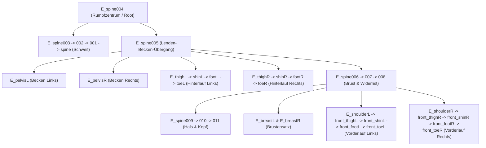

# Three.js Dokumentation: Animiertes 3D-Pferd mit GLTF/GLB & GUI-Steuerung

Diese Dokumentation erklärt den modularen Aufbau der Three.js-Anwendung zur Darstellung und Steuerung eines geriggten 3D-Pferdemodells. Der Schwerpunkt liegt auf der Funktionsweise des Ladevorgangs von GLB-Dateien, der Szenengraph-Traversierung und der Skelettanimations-Pipeline.

---

## 1. Szenenaufbau, Rendering & Kamera

```javascript
const scene = new THREE.Scene();
scene.background = new THREE.Color(0x1b1d23);

const camera = new THREE.PerspectiveCamera(75, window.innerWidth / window.innerHeight, 0.1, 1000);
camera.position.set(0, 2, 5);

const renderer = new THREE.WebGLRenderer({ antialias: true });
renderer.setSize(window.innerWidth, window.innerHeight);
renderer.setPixelRatio(Math.min(window.devicePixelRatio, 2));
document.body.appendChild(renderer.domElement);

```

* **`PerspectiveCamera(fov, aspect, near, far)`:** Simuliert das menschliche Auge. Das Sichtfeld (*Field of View*) beträgt **75°**, Clipping-Ebenen liegen zwischen **0.1** und **1000** Welteinheiten.
* **`renderer.setPixelRatio(Math.min(..., 2))`:** Verhindert Performance-Einbrüche auf hochauflösenden Bildschirmen (Retina/4K), indem die Pixeldichte auf maximal das 2-fache limitiert wird.
* **`window.addEventListener('resize', ...)`:** Aktualisiert bei Größenänderungen des Fensters das Seitenverhältnis der Kamera (`aspect`) sowie die Projektionsmatrix (`updateProjectionMatrix()`), damit das Modell nicht verzerrt wird.

---

## 2. Beleuchtung & visuelle Referenzen

```javascript
scene.add(new THREE.GridHelper(20, 20, 0x555a66, 0x2c3038));
scene.add(new THREE.AxesHelper(3));

scene.add(new THREE.AmbientLight(0xffffff, 1));
const keyLight = new THREE.DirectionalLight(0xffffff, 2.5);
keyLight.position.set(5, 8, 5);
scene.add(keyLight);

```

* **`AmbientLight`:** Streulicht ohne feste Quelle, hellt alle Flächen des Modells gleichmäßig auf und verhindert komplett schwarze Schatten.
* **`DirectionalLight`:** Paralleles Licht (wie Sonnenlicht). Durch die Positionierung bei `(5, 8, 5)` entsteht ein plastischer Schattierungseffekt auf der Muskulatur des Modells.
* **`GridHelper` & `AxesHelper`:** Dienen als räumliche Referenz (Rot = X, Grün = Y, Blau = Z) zur Überprüfung von Bodenkontakt und Hufpositionen.

---

## 3. Textur-Pipeline & Farbmanagement

```javascript
const textureLoader = new THREE.TextureLoader();
const horseTexture = textureLoader.load('/textures/Dark.png');
horseTexture.flipY = false; 
horseTexture.colorSpace = THREE.SRGBColorSpace;

```

* **`flipY = false` (Kritisch für GLTF/GLB):** Standardmäßig spiegelt Three.js Texturen vertikal an der Y-Achse (entsprechend dem klassischen OpenGL-Standard). Die **glTF 2.0-Spezifikation** definiert den UV-Koordinatenursprung jedoch oben links. Ohne `flipY = false` läge die Textur spiegelverkehrt oder fehlerhaft auf dem Pferdekörper.
* **`colorSpace = THREE.SRGBColorSpace`:** Stellt sicher, dass die Textur im sRGB-Farbraum dekodiert und vom Shader im linearen Farbraum verarbeitet wird. Fehlt diese Angabe, wirkt das Modell verwaschen oder farblich verfälscht.

---

## 4. Deep-Dive: Die GLB-Ladelogik & Szenengraph (`GLTFLoader`)

Der Abschnitt rund um `gltfLoader.load(...)` ist das funktionale Herzstück der Anwendung.

```javascript
const gltfLoader = new GLTFLoader();

gltfLoader.load(
  'models/Horse.glb',
  (gltf) => {
    const horse = gltf.scene;

    horse.traverse((child) => {
      if (child.isMesh) {
        child.material.map = horseTexture;
        child.material.needsUpdate = true;
      }
    });

    scene.add(horse);
    // ...
  }
);

```

### Was ist eine GLB-Datei?

Eine `.glb`-Datei ist die binäre Container-Variante von glTF (*GL Transmission Format*). Sie packt alle 3D-Daten in ein einzelnes File:

* **JSON-Header:** Beschreibt die Hierarchie (Nodes, Kameras, Lichter, Bones).
* **Binär-Chunk:** Enthält Vertex-Puffer (Positionen, Normalen, UVs, Skin-Gewichte).
* **Animation-Tracks:** Enthält Keyframes für Knochenrotationen und -positionen.

### Die Komponenten des Ladevorgangs

1. **`gltf.scene` (Root Node):**
Das vom Loader zurückgegebene Objekt ist eine hierarchische Baumstruktur (`THREE.Group` oder `THREE.Object3D`). Sie enthält alle Meshes, Knochenketten (*Armature*) und Transformationen des Modells.
2. **`horse.traverse(callback)` (Rekursive Traversierung):**
Ein GLB-Modell besteht fast nie aus nur einem einzelnen Objekt, sondern aus Untergruppen, Nodes und separaten Teil-Meshes (z. B. Körper, Mähne, Augen). `traverse` iteriert Tiefen-zuerst (*Depth-First*) durch jeden einzelnen Knoten des Modells:
* **`child.isMesh`:** Prüft, ob der aktuelle Knoten ein renderbares 3D-Gitter ist (oft ein `THREE.SkinnedMesh` bei geriggten Charakteren) und ignoriert reine Hilfsknoten wie Bones oder Transform-Gruppen.
* **`child.material.map = horseTexture`:** Weist dem Material des Teil-Meshes die geladene Textur zu.
* **`child.material.needsUpdate = true`:** Signalisiert Three.js, dass die Shader-Programme auf der GPU mit der neuen Textur-Bindung neu kompiliert bzw. aktualisiert werden müssen.


---

## 5. Skelettanimations-Pipeline & Weiche Übergänge

Three.js trennt Skelettanimationen in drei Ebenen: **Daten** (`AnimationClip`), **Verwaltung** (`AnimationMixer`) und **Zustand** (`AnimationAction`).

```
gltf.animations (Array aus AnimationClips)
       │
       ▼
THREE.AnimationMixer (Globale Zeitverwaltung des Pferdes)
       │
       ▼
actions[clip.name] = mixer.clipAction(clip) (Steuert Abspielstatus & Blending)

```

### Initialisierung der Aktionen

```javascript
mixer = new THREE.AnimationMixer(horse);

const animNames = [];
gltf.animations.forEach((clip) => {
  actions[clip.name] = mixer.clipAction(clip);
  animNames.push(clip.name);
});

settings.currentAnimation = animNames[0];
activeAction = actions[settings.currentAnimation];
activeAction.play();

```

* **`THREE.AnimationMixer(horse)`:** Der Treiber aller Skelettdeformationen. Er synchronisiert die Posen der Knochen (`THREE.Bone`) bezogen auf das `horse`-Objekt.
* **`mixer.clipAction(clip)`:** Erstellt aus einem statischen Rohdaten-Clip (`AnimationClip`) eine instanziierte Kontroll-Aktion (`AnimationAction`). Hierüber werden Loop-Modi, Gewichtung (*Weight*) und Zeitskalierung kontrolliert.

### Flüssiges Überblenden (Crossfading)

```javascript
function transitionTo(nextName) {
  const nextAction = actions[nextName];
  if (!nextAction || nextAction === activeAction) return;

  nextAction.reset();
  nextAction.enabled = true;
  nextAction.play();

  activeAction.crossFadeTo(nextAction, settings.crossfadeDuration, true);
  activeAction = nextAction;
}

```

* **Problem bei hartem Wechsel:** Stoppt man eine Gangart (z. B. Schritt) und startet sofort Galopp, springen die Knochen ruckartig von einer Pose in die nächste.
* **Lösung mit `crossFadeTo(nextAction, duration, warp)`:**
1. `nextAction` wird aktiviert und läuft parallel zur alten Animation an.
2. Über die Dauer `crossfadeDuration` (z. B. 0.5 Sekunden) blendet Three.js das Gewicht der aktuellen Aktion von **1 auf 0** herunter und gleichzeitig das Gewicht der Zielaktion von **0 auf 1** herauf.
3. Die Knochenpositionen und -rotationen werden in jedem Frame linear interpoliert (SLERP für Rotations-Quaternionen), wodurch ein nahtloser morphingartiger Bewegungsübergang entsteht.


---

## 6. Konsolidierte Steuerung: Das Skelett-Studio

Statt unübersichtlicher Standard-Menüs (`lil-gui`) und separater Einzelfenster sind alle Steuer- und Analysefunktionen in einem einzigen, modernen **Skelett-Studio** an der Seite zusammengefasst.

* **Zentralisiert:** Gangarten, Geschwindigkeiten, Hufschwellwerte, 3D-Rigg-Visualisierungen und Timeline sind in 5 Reitern ergonomisch vereint.
* **Minimalistischer Viewport:** Der 3D-Canvas bleibt frei von störenden Standard-Overlays.
* **Tastatur-Kürzel:** Mit <kbd>B</kbd> oder <kbd>Tab</kbd> kann das gesamte Studio nahtlos ein- und ausgeblendet werden.

---

## 7. Render-Loop & Frame-Timing (`THREE.Timer`)

```javascript
const timer = new THREE.Timer();

function animate(timestamp) {
  requestAnimationFrame(animate);

  timer.update(timestamp);
  const delta = timer.getDelta();

  if (mixer) {
    mixer.update(delta);
  }

  controls.update();
  renderer.render(scene, camera);
}
requestAnimationFrame(animate);

```

* **`THREE.Timer` vs. `requestAnimationFrame`:** `requestAnimationFrame` liefert zwar einen Zeitstempel, aber die Bildwiederholrate variiert je nach Monitor (60 Hz, 144 Hz) oder Last.
* **`timer.update(timestamp)` & `timer.getDelta()`:** Ermittelt exakt die vergangene Zeit $\Delta t$ (in Sekunden) seit dem letzten Frame.
* **`mixer.update(delta)`:** Rechnet die Keyframe-Transformationen exakt um das Zeitintervall weiter. Dadurch läuft die Animation auf einem 60-Hz- und einem 144-Hz-Display physikalisch exakt gleich schnell ab (*Frame-Rate Independence*).
* **`controls.update()`:** Berechnet das träge Nachschwingen der Kamera (*Damping*).

---

## 8. Hufkontakt-Analyse & Schwellwert-Ermittlung

Um präzise zu erkennen, wann die Hufe den Boden ($Y = 0$) berühren und wann sie sich in der Luft befinden, werden die Knochenkoordinaten der Zehenglieder kontinuierlich ausgewertet.

### 8.1 Knochenhierarchie & anatomische Ursachen für zwei Schwellwerte

Eine messtechnische Abtastung der Knochenkoordinaten (`getWorldPosition`) über alle Animations-Keyframes ergab folgende Wertebereiche:

| Huf / Knochen | Knochenname | Ruhelage (Rest) | Min. Höhe (Boden) | Max. Höhe (Luft) | Empfohlener Schwellwert |
| :--- | :--- | :--- | :--- | :--- | :--- |
| **Vorne Links (VL)** | `E_front_toeL` | `0.1416 m` | `0.1352 m` | `0.4665 m` | **`0.155 m`** |
| **Vorne Rechts (VR)** | `E_front_toeR` | `0.1416 m` | `0.1360 m` | `0.4374 m` | **`0.155 m`** |
| **Hinten Links (HL)** | `E_toeL` | `0.2512 m` | `0.2416 m` | `0.6068 m` | **`0.265 m`** |
| **Hinten Rechts (HR)** | `E_toeR` | `0.2512 m` | `0.2416 m` | `0.6068 m` | **`0.265 m`** |

#### Warum zwei unterschiedliche Schwellwerte?
1. **Unterschiedliche Knochenhöhe im Rig:** Das 3D-Gitter (*Mesh*) der Hufe schließt an allen vier Hufen bei exakt $Y = 0.000$ mit dem Boden ab. Die Knochenursprünge (*Bone Origins*) der Zehenglieder sitzen im Skelett jedoch auf unterschiedlichen Höhen:
   * Die vorderen Zehenknochen (`E_front_toeL / R`) sitzen tiefer im Huf auf ca. **`0.14 m`**.
   * Die hinteren Zehenknochen (`E_toeL / R`) sitzen anatomisch bedingt (Fesselgelenk-Geometrie des Rigs) höher auf ca. **`0.25 m`**.
2. **Schwellwert-Logik:**
   * Ein Huf gilt als **am Boden**, wenn $Y_{\text{Knochen}} \le \text{Schwellwert}$.
   * Ein Huf gilt als **in der Luft**, wenn $Y_{\text{Knochen}} > \text{Schwellwert}$.
   * Durch `thresholdFront = 0.155 m` und `thresholdBack = 0.265 m` wird ein robuster Toleranzbereich von ca. $1.5\text{ cm}$ über dem minimalen Bodenwert gewährleistet.

### 8.2 Visuelle 3D-Bodenkontakt-Anzeige

* **3D-Bodenringe & Höhenlinien:** Direkt unter jedem Huf wird ein Kontaktring auf den Boden ($Y = 0.002$) projiziert. Bei Bodenkontakt leuchtet der Ring grün mit gefüllter Scheibe; in der Luft wird er transparent und zeigt als Schatten die Bodenprojektion. Eine dynamische Höhenlinie visualisiert die Distanz zum Boden.
* **Studio-Integration:** Sämtliche Schwellwerte, Live-Zustände aller 4 Hufe (BODEN/LUFT), Aufprallgeschwindigkeiten sowie die Phasen-Diagramme sind vollständig im Studio-Seitenpanel (Reiter *Biomechanik*) integriert.

### 8.3 Physikalisch basierte Staubwolken-Simulation (Partikelsystem)

Trifft ein Huf auf den Boden auf (*Touchdown*-Event in `GroundContactDetector`), wird am exakten Aufprallpunkt $(X, 0, Z)$ eine physikalische Staubwolke ausgelöst, die die **Laufrichtung und Geschwindigkeit** des Pferdes berücksichtigt:

1. **Laufrichtung & Rückwärts-Schub (Staubspur nach hinten):**
   - Die aktuelle 3D-Laufrichtung $\vec{u}_{\text{forward}}$ des Pferdes wird per `horse.getWorldDirection()` in Echtzeit ermittelt.
   - Die Geschwindigkeit des Pferdes ($v_{\text{Pferd}}$: *Walk* $\approx 1.6\text{ m/s}$, *Trot* $\approx 3.8\text{ m/s}$, *Gallop* $\approx 8.5\text{ m/s}$ oder reale Welt-Translation) erzeugt einen entgegengesetzten Rückwärts-Vektor $\vec{v}_{\text{backward}} = -\vec{u}_{\text{forward}} \cdot (v_{\text{Pferd}} \cdot k_{\text{kick}})$.
   - Hinterhufe erhalten durch den Hufabstoß (Propulsion) einen zusätzlichen Vortriebs-Schub nach hinten.
2. **Ring- & Fächerstreuung mit leichtem Auftrieb:**
   - Horizontale Ringdispersion kombiniert mit dem Rückwärts-Schub ergibt eine charakteristische, nach hinten wehende Fächer-/Tränenform.
   - Jeder Partikel erhält einen positiven Vertikalimpuls ($v_y > 0$, Auswurfswinkel ca. $25^\circ - 35^\circ$).
3. **Bremsung durch Luftwiderstand (Stokes-Drag):**
   - Gemäß $\vec{F}_{\text{drag}} = -c_{\text{drag}} \cdot m \cdot \vec{v}$ werden alle Geschwindigkeiten gedämpft ($\vec{v} \mathrel{*}= e^{-c_{\text{drag}} \cdot \Delta t}$).
   - Dadurch verlangsamt sich der rasante Rückwärtsflug und die Partikel verweilen als stehende Staubschleppe in der Luft.
4. **Schwerkraft (Gravitation):**
   - Die Vertikalbeschleunigung $a_y = -g - c_{\text{drag}} \cdot v_y$ bremst den Aufstieg, lässt die Partikel ihren Scheitelpunkt erreichen und sanft zum Boden absinken.
5. **Bodenkontakt & Verblassen:**
   - Am Boden ($Y \le 0.005$) greift Bodenreibung. Die Partikel verblassen graduell ($\alpha \to 0$) bei gleichzeitiger volumetrischer Expansion des Radius.
6. **Abhängigkeit vom Auftritt:**
   - Partikelanzahl und Impuls skalieren dynamisch mit der Gangart (*Walk* $\approx 12$, *Trot* $\approx 35$, *Gallop* $\approx 65$ Partikel) sowie der Aufprallgeschwindigkeit.

---

## 9. Skelett-Studio & Analyse-Tool (Seitenpanel)

Um das Skelett bis ins kleinste Detail inspizieren und manuell steuern zu können, verfügt die Anwendung über ein vollwertiges **Skelett- und Biomechanik-Studio** am rechten Bildschirmrand (Taste `B` oder `Tab` zum Ein-/Ausblenden).

```
   ┌─────────────────────────────────────────────────────────────────┐
   │ 🦴 SKELETT-STUDIO (Seitenpanel)                                │
   ├───────────┬─────────────┬────────────┬─────────────┬────────────┤
   │ 🌳 Baum   │ 🎛️ Knochen  │ ⏱️ Timeline │ 📊 Biomech  │ 👁️ Ansicht │
   └───────────┴─────────────┴────────────┴─────────────┴────────────┘
```

### 9.1 Wie baut sich das Skelett auf? (Anatomische Hierarchie)

Das Skelett des Pferdes besteht aus **34 Knochen (`THREE.Bone`)**, die als hierarchischer Baum (*Szenengraph*) organisiert sind. Jede Drehung eines Elternknochens vererbt sich über Vorwärtskinematik (*Forward Kinematics*) an alle Unterglieder:



#### Die 6 Körperregionen & 34 Knochen im Überblick:

1. **Rumpfzentrum & Wirbelsäule (5 Knochen):**
   * `E_spine004`: **Wurzelknochen (Root)** – Schwerpunkt des Pferdes.
   * `E_spine005`: Lenden-Kreuzbein-Übergang.
   * `E_spine006` – `E_spine008`: Hintere bis vordere Brustwirbel und Widerrist.
2. **Kopf & Hals (3 Knochen):**
   * `E_spine009` (Halsbasis), `E_spine010` (Nacken), `E_spine011` (Schädel, Maul, Kiefer).
3. **Vorderbeine & Schultergürtel (10 Knochen):**
   * Links: `E_shoulderL` (Schulterblatt) $\rightarrow$ `E_front_thighL` (Oberarm) $\rightarrow$ `E_front_shinL` (Unterarm) $\rightarrow$ `E_front_footL` (Vorderfußwurzel) $\rightarrow$ `E_front_toeL` (Huf).
   * Rechts: `E_shoulderR` $\rightarrow$ `E_front_thighR` $\rightarrow$ `E_front_shinR` $\rightarrow$ `E_front_footR` $\rightarrow$ `E_front_toeR`.
4. **Hinterbeine & Becken (10 Knochen):**
   * Links: `E_pelvisL` (Hüfte) $\rightarrow$ `E_thighL` (Oberschenkel) $\rightarrow$ `E_shinL` (Unterschenkel) $\rightarrow$ `E_footL` (Sprunggelenk) $\rightarrow$ `E_toeL` (Huf).
   * Rechts: `E_pelvisR` $\rightarrow$ `E_thighR` $\rightarrow$ `E_shinR` $\rightarrow$ `E_footR` $\rightarrow$ `E_toeR`.
5. **Schweif / Caudalwirbel (4 Knochen):**
   * `E_spine003` $\rightarrow$ `E_spine002` $\rightarrow$ `E_spine001` $\rightarrow$ `E_spine` (Schweifspitze).
6. **Brustregion (2 Knochen):**
   * `E_breastL`, `E_breastR` (vordere Brustwand).

---

### 9.2 Die Funktionen des Analyse-Tools

Das Seitenpanel gliedert sich in 5 interaktive Spezialbereiche:

#### 1. 🌳 Hierarchie-Baum (Tree View)
* **Interaktiver Klappbaum:** Zeigt alle 34 Knochen mit Tiefe, Icons, technischen und anatomischen Bezeichnungen an.
* **Körperschnellfilter & Live-Suche:** Filterchips für `Wirbelsäule`, `Vorderbeine`, `Hinterbeine`, `Kopf & Hals`, `Schweif` sowie Volltextsuche.
* **3D-Raycasting-Auswahl:** Klick auf einen Knochen im Baum oder direkt auf eine Gelenkkugel im 3D-View hebt den Knochen hervor und öffnet die Detail-Steuerung.

#### 2. 🎛️ Knochen-FK & Pose-Editor
* **Live-Telemetrie:** Exakte Weltposition $(X, Y, Z)$, Höhe über dem Boden ($Y$), Rotationswinkel und Hierarchiedaten.
* **Freies Posing & Überlagerung:**
  * **Additiver Offset:** Überlagert flüssig die laufende Gangart (z. B. Kopf im vollen Galopp anheben oder zur Seite neigen).
  * **Absolutes Posing:** Fixiert die Knochenwinkel framegenau.
* **3-Achsen-Rotation:** Slider für Neigung (Pitch $X$), Gieren (Yaw $Y$) und Rollen (Roll $Z$) von $-180^\circ$ bis $+180^\circ$.
* **Positions-Offset & Skalierung:** Feine Justierung für jeden Knochen.
* **Schnell-Posen (Presets):** *Stolzer Hals*, *Grasen*, *Schweif erhoben*, *Aufbäumen*.
* **Kamerafokus:** Mit Klick auf `🎯 Fokus` schwenkt die Orbit-Kamera zentriert auf den ausgewählten Knochen.

#### 3. ⏱️ Timeline & Playback
* **Framegenauer Scrubber:** Schieberegler mit Live-Zeitanzeige (`0.45s / 1.20s`) und Frame-Index.
* **Einzelschritt-Steuerung:** Frame-vor (`>`) und Frame-zurück (`<`) für mikroskopische Bewegungsanalysen.
* **Geschwindigkeit:** Stufenlos von $0.05\times$ (Superzeitlupe) bis $2.5\times$ mit Schnellwahltasten.
* **Überblendung:** Einstellbare Crossfade-Dauer für Gangartwechsel.

#### 4. 📊 Biomechanik & Phasen-Diagramm
* **Echtzeit-Schrittdiagramm (Gait Phase Diagram):** Ein kontinuierlich rollendes Diagramm visualisiert die Stütz- (Grün) und Schwungphasen (Blau) aller vier Hufe synchron.
* **4-Huf-Telemetrie mit dynamischen Pegelbalken:** Visuelle Balkenanzeigen für alle vier Hufe (VL, VR, HL, HR). Der animierte Füllstand spiegelt kontinuierlich die Welt-Höhe des Zehenknochens ($Y$) wider, während eine präzise Schwellwertmarkierung (Notch) die Grenze zwischen Bodenkontakt (`BODEN`, Grün) und Flugphase (`LUFT`, Blau) exakt darstellt.
* **Gangart-Rhythmen:**
  * *Walk (Schritt):* 4-Takt-Einzelfußung.
  * *Trot (Trab):* 2-Takt-Diagonalsynchronisation (VL+HR vs. VR+HL).
  * *Gallop (Galopp):* 3-Takt mit deutlicher Flug-/Schwebephase.
* **Auto-Kalibrierung:** Ein-Klick-Fitting der Schwellwerte für Vorne und Hinten.

#### 5. 👁️ 3D-Rigg- & Material-Ansicht
* **SkeletonHelper:** Ein- und Ausblenden der 3D-Skelettlinien im Raum.
* **Gelenk-Kugeln (Joint Markers):** 3D-Kugeln an allen 34 Gelenken mit Farbkennzeichnung.
* **Lokales Koordinatensystem:** Achsenkreuz (Rot=$X$, Grün=$Y$, Blau=$Z$) direkt am aktiven Knochen.
* **Röntgenmodus (X-Ray):** Schaltet das Pferdemodell auf $30\%$ Transparenz, sodass das Skelett im laufenden Körper vollständig sichtbar ist.
* **Wireframe-Modus:** Zur visuellen Kontrolle der Vertex-Deformation und Skinning-Gewichte.
* **Textur-Switcher:** Umschalten zwischen *Brown*, *Dark Brown*, *Black*, *Grey* und *White*.
* **Kamera-Presets:** *Seitenansicht (Sagittal)*, *Frontalansicht*, *Draufsicht*, *Isometrisch*, *Huf-Nahaufnahme*.